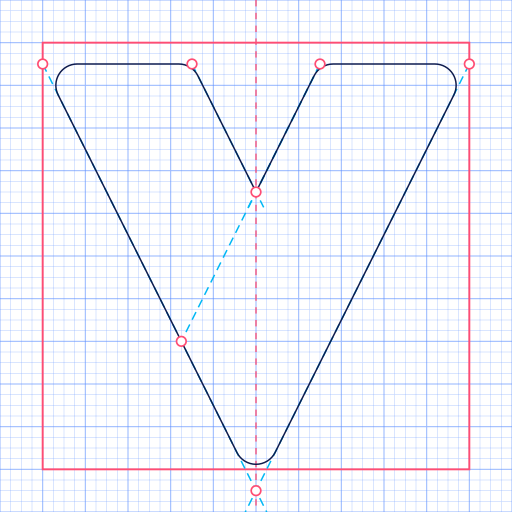

# Vitrine app icon: sources

The icon ("Lastre") is hand-built vector art in the Windows 11 Fluent app-icon style: an abstract **V**
made of two panes. A lit lagoon pane (the left arm) lies behind, a deep lagoon pane (the right arm)
crosses over it down to the tip, and an ember orb, the widget, is tucked between them.
Everything in `assets/icon/` is generated from the two Python files here.

| File | What it is |
| --- | --- |
| `lastre.py` | The icon. `lastre(size)` draws the master (size ≥ 48) or a pixel-fitted small frame (32, 24, 20, 16). Also writes `construction.svg`. |
| `kit.py` | Small SVG helpers: 120° Fluent gradients, the two-layer drop shadow, inner highlights, rounded rectangles and polygons. |
| `build.js` | Rasterises the SVGs with resvg, re-encodes the PNGs (zlib 9, adaptive filters) and packs `vitrine.ico`. |
| `avatar.js` | GitHub organisation avatar (icon centred on a light and a dark tile). |
| `construction.svg` | Reference drawing: 48 grid, square keyline, construction lines and key points. |

## Regenerate

Requires Python 3 (standard library only) and Node 18+.

```sh
cd assets/icon/src
npm ci          # first time only: installs @resvg/resvg-js
npm run build   # = python lastre.py && node build.js
```

The website (`vitrine-org/vitrine-org.github.io`) keeps its own copy of the master as logo and favicon:
copy `../vitrine.svg` there after changing the icon.

## Output (`assets/icon/`)

| Path | Use |
| --- | --- |
| `vitrine.svg` | Master artwork (48-unit grid, rendered at 256). Also the website logo and favicon. All ids are prefixed `vit-`, so the SVG can be inlined safely. |
| `vitrine-1024.png` | Master raster for stores and marketing. |
| `vitrine.ico` | Windows icon: 16, 20, 24, 32, 40, 48 and 64 px as 32-bit BMP frames, 256 px as PNG. |
| `png/vitrine-<size>.png` | Individual frames: 16, 20, 24, 32, 40, 48, 64, 96, 128, 256. |
| `svg/vitrine-<size>.svg` | The pixel-fitted small drawings (32, 24, 20, 16). |

## Design rules



- **Grid.** `viewBox="0 0 48 48"` (Microsoft's 48-unit icon grid): 1 unit is 1 px at 48 px. The V spans
  the 40 × 40 square keyline horizontally (x 4–44, margin 4).
- **Construction.** Every outer edge is a 1:2 grid diagonal (dx:dy), so edges pass through grid
  intersections. Arms are 14 u wide at the top (12.5 u across the slope). Key points are whole units:
  tops (4,6) (18,6) (30,6) (44,6), notch (24,18), crossing (17,32), geometric tip (24,46).
- **Tip.** The geometric tip lies outside the keyline; the 2 u corner radius pulls the visible tip up to
  43.5, inside it. This is the optical compensation for a pointed bottom, and it also lowers the V a
  little, which balances its top-heavy mass.
- **Radii.** 2 u on exterior corners, as Microsoft specifies at 48 × 48. No radius where the two panes
  cross: that is an occlusion edge, not a curve.
- **Small frames are redrawn, not scaled.** `ANCHORS` in `lastre.py` re-lays each of 32, 24, 20 and
  16 px so the top edge and the outer x extents fall on whole device pixels, keeping the 1:2 slope
  (one pixel step every two rows). Detail drops by size: inner highlights below 48 px, the orb and all
  shadows below 32 px; below 32 px the lit ramp starts one step deeper so the arm holds on the light
  taskbar.
- **Light.** Ambient light from the top left; every ramp runs light top-left to deep bottom-right at
  120°, as the Fluent guidelines recommend.
- **Shadows.** Two-layer drop shadow (key: 1 u down, 1 u blur, 22 %; contact: 0.25 u down, 0.25 u
  blur, 18 %). The front pane's shadow (1 u down, 1.1 u blur, 32 %) is masked into the back pane and
  the orb.
- **Contrast.** Microsoft asks for at least half of the icon at 3:1 on both themes. Measured on the
  256 px master: 60 % of the pixels on the light taskbar (#F3F3F3), 75 % on the dark one (#202020).
- **Palette: Lagoon & Ember.**
  - Lagoon `#6BF2E2 → #1EE0D2 → #00B8F5 → #1A7CFF → #2B4DE0 → #1C2A8F`: lit pane `l1 → l3 → l4`,
    front pane `l4 → l5 → l6`.
  - Ember `#FFF1A8 → #FFB23E → #FF7A45 → #FF4D73`: the orb.
  - Ink is `#0E1B4D` (shadows).

The previous concept ("Acrylic", two square panes with the orb between them) is in the git history
before this file's rewrite.
